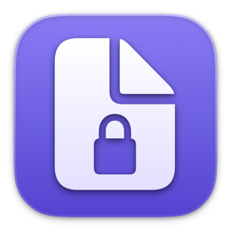

<p align="center">
  
</p>

<h1 align="center">DOTFOLIO</h1>

<p align="center">
  Every <code>.env</code>, safe in your Keychain.<br>
  Native macOS app. Free and open source.
</p>

<p align="center">
  <a href="https://github.com/t0dida00/DotFolio/releases/latest">Download</a> ·
  <a href="https://github.com/t0dida00/DotFolio/releases">Releases</a> ·
  <a href="https://github.com/t0dida00/DotFolio/issues">Issues</a>
</p>

<p align="center">
  <a href="https://github.com/t0dida00/DotFolio/releases"></a>
  <a href="LICENSE"></a>
</p>

---

## About

DOTFOLIO is what I wanted my `.env` files to be: in one place, locked, and still easy to use. Each value lives in the macOS Keychain behind Touch ID. Next to it, DOTFOLIO keeps what you forget months later: what the key is for, who provides it, which account created it, and where to manage it.

It's built with Swift 6, SwiftUI and SwiftData. Secret values never touch the database or the logs, and reach a file only when you export one.

## Why DOTFOLIO

Your options for project secrets today:

- **`.env` files**: plain text in every project folder, copied between machines, one `git add .` away from a leak.
- **Password managers**: they keep a value safe, but don't know your projects, environments or which provider a key belongs to.
- **Cloud secret managers** (Doppler, Infisical, Vault): built for teams and servers; your values live on someone else's infrastructure.

DOTFOLIO is the missing one: native, local, organized around your projects, and open source.

## Installation

| Platform | Status | Install |
| --- | --- | --- |
| macOS 26+ | Stable | Download the `.zip` from [GitHub Releases](https://github.com/t0dida00/DotFolio/releases/latest) |
| Linux / Windows | Not planned | DOTFOLIO relies on the macOS Keychain and Touch ID |

Unzip, move **DOTFOLIO.app** to Applications, and open it. Builds aren't notarized yet, so the first time macOS asks for confirmation: right-click ▸ Open, or allow it in System Settings ▸ Privacy & Security.

**DOTFOLIO ▸ Check for Updates…** tells you when a new version is out. Replace the app; your projects and Keychain values carry over.

## Features

- Projects with development, staging and production, as a table or as a `.env` file you can edit.
- Import a GitHub repository and its `.env.example`, read-only.
- Drop a project folder: DOTFOLIO finds its `.env*` files and asks which to import.
- Drop `.env` files on a project or the Library: values already there are never overwritten.
- Tables open read-only: double-click a row to copy it as `KEY=value #Service/Provider/Account/Link`.
- Show Values reveals a whole table after one Touch ID prompt; long values open in a larger editor.
- Smart sources: Service and Provider guessed from 150+ providers, well-known names and key formats.
- A Library of reusable keys, next to every project's keys, filtered by environment.
- Accounts: the logins your keys come from, and every key that uses them.
- Overview: missing values, keys without a source, stale values, providers and services in use.
- Export `.env` to the clipboard (cleared after 60 seconds), the project folder or anywhere.
- Search projects, keys, providers and accounts; open projects in tabs.
- Verify Data cross-checks the database against the Keychain and repairs what it safely can.

## Security

- Values are stored only in the data protection keychain, tied to the app's signature.
- Items are this-Mac-only and readable only while the Mac is unlocked; they are never synced to iCloud.
- The Keychain itself requires Touch ID or the Mac password to return a value, not just the UI.
- One unlock per session; it locks after 5 minutes idle, on sleep and on screen lock.
- Keychain items are removed before the metadata that points to them, so no secret is orphaned.
- GitHub access is read-only. The app is sandboxed, with outgoing HTTPS only.

Values never leave your Mac, so wiping or losing it loses them. Keep an export of what matters somewhere safe.

## Free and open source

DOTFOLIO is free, with no account, subscription or telemetry. The code is MIT-licensed; use it, fork it, ship your own build. If you do, create your own GitHub App for sign-in (see [Build and contribute](#build-and-contribute)).

## Build and contribute

You need macOS 26, Xcode 26 or later, [XcodeGen](https://github.com/yonaskolb/XcodeGen) and an Apple ID signed in to Xcode. The data protection keychain needs a signed build.

```sh
git clone https://github.com/t0dida00/DotFolio.git
cd DotFolio
xcodegen generate   # after setting DEVELOPMENT_TEAM in project.yml
open DotFolio.xcodeproj
```

- App (SwiftUI views): [`DotFolio/`](DotFolio)
- Logic and tests (Swift package): [`Packages/DotFolioKit/`](Packages/DotFolioKit). Run `swift test` there.
- Conventions, security rules and the release checklist: [CLAUDE.md](CLAUDE.md)
- GitHub sign-in: create a GitHub App with *Contents* and *Metadata* read-only and Device Flow enabled, then set its Client ID in [`GitHubConfig.swift`](DotFolio/App/GitHubConfig.swift).

Keep views thin and put logic in `DotFolioKit` with tests. Open an issue before large changes.

## Docs and community

- [Releases](https://github.com/t0dida00/DotFolio/releases): what changed in each version
- [Issues](https://github.com/t0dida00/DotFolio/issues): bugs and feature requests. Include your macOS version, the DOTFOLIO version (shown under the logo) and steps to reproduce.
- [Report a vulnerability](https://github.com/t0dida00/DotFolio/security/advisories/new) privately; please don't open a public issue for security problems.

## Contributors

<a href="https://github.com/t0dida00/DotFolio/graphs/contributors">
  
</a>

Want to join them? Read [Build and contribute](#build-and-contribute).

## Star History

<a href="https://star-history.com/#t0dida00/DotFolio&Date">
  <picture>
    <source media="(prefers-color-scheme: dark)" srcset="https://api.star-history.com/svg?repos=t0dida00/DotFolio&type=Date&theme=dark">
    <source media="(prefers-color-scheme: light)" srcset="https://api.star-history.com/svg?repos=t0dida00/DotFolio&type=Date">
    
  </picture>
</a>

## License

DOTFOLIO is licensed under the [MIT License](LICENSE).
